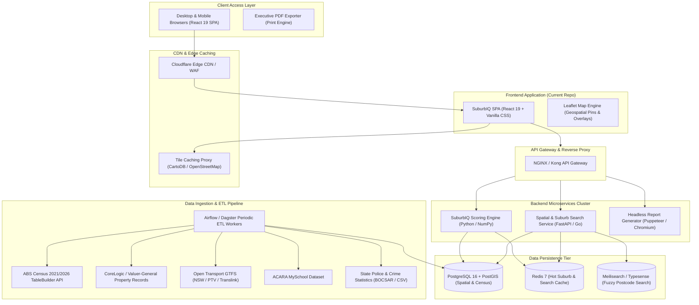

# SuburbIQ 🇦🇺 — Engineering Handbook & System Topology

> **Internal Developer & Systems Documentation**  
> *Hyper-Local Australian Suburb, Demographic & Property Intelligence Platform*

---

## 📑 Table of Contents
1. [Executive Summary & Domain Overview](#-executive-summary--domain-overview)
2. [End-to-End System Topology & Architecture](#-end-to-end-system-topology--architecture)
3. [Repository File & Directory Structure](#-repository-file--directory-structure)
4. [Frontend Component Architecture & Data Flow](#-frontend-component-architecture--data-flow)
5. [Backend Architecture & Data Ingestion Pipeline](#-backend-architecture--data-ingestion-pipeline)
6. [Database Schema & Spatial Storage](#-database-schema--spatial-storage)
7. [Proprietary Scoring Algorithm (SuburbIQ Index)](#-proprietary-scoring-algorithm-suburbiq-index)
8. [Local Development & Environment Setup](#-local-development--environment-setup)
9. [Production Deployment & Infrastructure](#-production-deployment--infrastructure)
10. [Roadmap & Engineering Milestones](#-roadmap--engineering-milestones)

---

## 📌 Executive Summary & Domain Overview

While traditional real estate portals (e.g., Domain, RealEstate.com.au) operate as listing advertising channels, **SuburbIQ** (inspired by the analytical foundations of Microburbs) provides **hyper-local spatial, demographic, and lifestyle intelligence**.

The core premise is to help homebuyers, buyers agents, property developers, and institutional investors analyze Australian suburbs through empirical metrics:
- **Micro-Demographics**: ABS Census breakdown down to SA1/SA2 meshblocks (household income distributions, education levels, household family types, housing tenure).
- **Liveability & Lifestyle Indices**: Proprietary 0–100 scores for Vibe/Culture, Family Suitability, Transit Connectivity, Affluence, Greenery/Quiet, and Safety.
- **Amenities Catchments**: ACARA ICSEA school performance rankings, public transit corridor frequencies (GTFS), dining/cafe density, and open parklands.
- **Property Economics**: Median house and unit valuations, 12-month capital growth, rental yields, auction clearance rates, and days on market.

---

## 🏗️ End-to-End System Topology & Architecture

The following diagram outlines the high-level production topology, data ingestion pipeline, and runtime delivery model:



---

## 📂 Repository File & Directory Structure

```
aus-suburbs/
├── .gitignore                     # Git ignore rules for node_modules, build artifacts, and env files
├── .oxlintrc.json                 # Oxlint high-performance linter configuration
├── index.html                     # HTML root entrypoint (fonts, Leaflet stylesheets, meta tags)
├── package.json                   # Project manifest, scripts, and runtime dependencies
├── package-lock.json              # Deterministic npm dependency lockfile
├── README.md                      # Comprehensive developer handbook and systems topology
├── vite.config.js                 # Vite bundler configuration with React plugin
├── public/                        # Static assets served untouched at root
│   ├── favicon.svg                # Emerald compass brand SVG favicon
│   └── icons.svg                  # SVG sprite icons
└── src/                           # Frontend application source directory
    ├── main.jsx                   # React 19 bootstrap and DOM mount entrypoint
    ├── index.css                  # Global design tokens, CSS variables, typography, reset rules
    ├── App.jsx                    # Top-level application coordinator (navigation state & view routing)
    ├── App.css                    # Layout container styles and responsive platform footer
    ├── assets/                    # Bundled graphics, icons, and hero visuals
    │   ├── hero.png
    │   ├── react.svg
    │   └── vite.svg
    ├── data/                      # Client-side data models and fallback seed intelligence
    │   └── suburbsData.js         # Comprehensive demographic, property, and score dataset (23 enclaves)
    └── components/                # Modular UI component suite
        ├── Navbar.jsx             # Top sticky navbar with global search autocomplete and region filters
        ├── Navbar.css             # Search dropdown and glassmorphic header styling
        ├── HeroExplore.jsx        # Landing hero banner, intelligence stats ticker, and suburb card grid
        ├── HeroExplore.css        # Hero styling and responsive grid layouts
        ├── SuburbMap.jsx          # Interactive Leaflet map with metric heatmap switcher and pin badges
        ├── SuburbMap.css          # Map controls, custom HTML marker pins, and floating peek card
        ├── SuburbDossier.jsx      # Deep-dive "Microburb" modal (lifestyle radar, ABS demographics, schools)
        ├── SuburbDossier.css      # Dossier modal tabs, demographic comparison bars, and pocket cards
        ├── SuburbComparison.jsx   # Side-by-side 3-suburb comparison matrix with auto-calculated winner tags
        ├── SuburbComparison.css   # Comparison showdown table and cell highlight styling
        ├── SuburbMatchmaker.jsx   # Interactive buyer criteria sliders (budget, vibe, yield, distance)
        ├── SuburbMatchmaker.css   # Filter sidebar and ranked affinity match cards styling
        ├── ScorecardIndex.jsx     # National master league table with multi-column sorting and filtering
        ├── ScorecardIndex.css     # Sortable table styling and metric pill tags
        ├── ReportModal.jsx        # Printable executive suburb briefing modal with print-to-PDF formatting
        └── ReportModal.css        # Clean print stylesheet (@media print rules)
```

---

## 💻 Frontend Component Architecture & Data Flow

### 1. State Management Architecture (`App.jsx`)
The frontend is structured as a reactive Single Page Application (SPA). To maintain zero runtime overhead and fast interactions, application state is managed cleanly using React 19 primitives:

- `activeTab`: Switches between primary modes (`explore`, `compare`, `matchmaker`, `scores`).
- `selectedCity`: Regional filtering (`all`, `NSW`, `VIC`, `QLD`, `WA`, `SA`, `ACT`).
- `activeSuburb`: Currently highlighted suburb object for map camera centering.
- `dossierSuburb`: Triggers the high-detail Suburb Dossier modal.
- `compareList`: Array of up to 3 suburbs for head-to-head comparison showdown.
- `reportSuburb`: Triggers the print-ready Executive Briefing Document modal.

### 2. Component Hierarchy & Interactions

```
App.jsx (Root Coordinator)
│
├── Navbar.jsx
│   ├── Search Input (Instant prefix matching on Name / Postcode / LGA)
│   ├── Navigation Tabs (Map & Intel | Compare | Matchmaker | Scorecard)
│   └── Metro Region Filter Bar (All Australia | Sydney | Melbourne | Brisbane...)
│
├── VIEW: explore (Default)
│   └── HeroExplore.jsx
│       ├── Header & Stats Ticker
│       ├── SuburbMap.jsx (Leaflet spatial map + CartoDB tiles)
│       │   ├── Metric Heatmap Dimension Toggles (Overall IQ, Vibe, Family, Transit, Price, Yield)
│       │   ├── Custom HTML DivIcon Pins
│       │   └── Floating Suburb Quick Peek Card
│       └── Suburb Cards Grid (Responsive cards with quick scores & dossier CTAs)
│
├── VIEW: compare
│   └── SuburbComparison.jsx
│       ├── Suburb Selection Controls (Add up to 3 suburbs)
│       ├── Property Market Head-to-Head Table
│       ├── Lifestyle Scores Comparison with Category Leader Ribbons
│       └── Census Micro-Demographics Showdown
│
├── VIEW: matchmaker
│   └── SuburbMatchmaker.jsx
│       ├── Interactive Criteria Sliders (Budget, Property Type, Min Vibe, Min Family, Max CBD Dist, Min Yield)
│       └── Real-time Match Algorithm & Affinity Ranking Cards
│
├── VIEW: scores
│   └── ScorecardIndex.jsx
│       ├── Live Search Filter
│       └── Sortable Master League Table across all financial & lifestyle metrics
│
├── MODAL: SuburbDossier.jsx (Triggered from Map, Cards, or Search)
│   ├── Hero & IQ Ring
│   ├── Property Market Fundamentals Strip
│   ├── Tab 1: Lifestyle Scores Matrix (Benchmark comparisons against state averages)
│   ├── Tab 2: Micro-Demographics (Weekly income gauge, household structure, tenure mix, ancestries)
│   ├── Tab 3: Schools & Amenities (ICSEA school catchments, transit hubs, cafe density)
│   └── Tab 4: Pocket Character (Strengths, cautions, buyer archetypes, future projects)
│
└── MODAL: ReportModal.jsx (Print & PDF Export)
    └── Printable Executive Suburb Intelligence Brief
```

### 3. Styling & Token Architecture (`index.css`)
SuburbIQ uses a bespoke Vanilla CSS design system built on CSS variables:
- **Base Background**: `--bg-primary: #090D16` (Deep Midnight Slate)
- **Elevated Surfaces**: `--bg-surface: #0F172A`, `--bg-card: #131E35`
- **Accents**:
  - Emerald: `--accent-emerald: #10B981` (Primary brand & growth)
  - Cyan: `--accent-cyan: #06B6D4` (Transit & safety)
  - Indigo/Purple: `--accent-purple: #8B5CF6` (Vibe & nightlife)
  - Amber: `--accent-amber: #F59E0B` (Affluence & cafes)
- **Glassmorphism**: `.glass-panel` utilizing `backdrop-filter: blur(16px)` and 1px translucent borders.

---

## ⚙️ Backend Architecture & Data Ingestion Pipeline

To scale SuburbIQ across all 15,000+ Australian suburbs, localities, and statistical areas, the planned backend microservices architecture operates as follows:

### 1. Ingestion Microservices (ETL Workers)
Executed via scheduled orchestrators (Dagster / Apache Airflow):

| Data Domain | Source Provider | Update Cadence | Key Ingested Attributes |
| :--- | :--- | :--- | :--- |
| **Census Demographics** | Australian Bureau of Statistics (ABS) TableBuilder | Annual / Quinquennial | Median weekly income, age distributions, housing tenure (rent/mortgage/outright), household family types, top ancestries. |
| **Property Valuation & Sales** | Valuer-General / CoreLogic / Domain API | Daily / Weekly | Settled sales, median house/unit values, 12m growth %, median weekly rents, rental yields, days on market, auction clearance rates. |
| **Public Transit & Commute** | Open Transport GTFS (NSW OpenData, Data VIC, Translink) | Monthly | Station positions, transit line types (heavy rail, metro, ferry, light rail), scheduled departures per hour, peak CBD transit times. |
| **Education & School Catchments** | ACARA (MySchool) & State Education Depts | Quarterly | Primary/Secondary schools, public/private/selective status, ICSEA percentile scores, NAPLAN aggregates, school catchment polygons. |
| **Crime & Community Safety** | State Crime Registers (NSW BOCSAR, Crime Statistics VIC) | Quarterly | Recorded offenses per 100k population, property crime rates, violent crime rates, safety trend direction. |
| **Amenities & Points of Interest** | OpenStreetMap (OSM) / Geocoded Business Registers | Monthly | Supermarkets, hospitals, playgrounds, cafes/eateries count per km², green canopy percentage from satellite imagery. |

---

## 🗄️ Database Schema & Spatial Storage

The primary transactional and analytical store uses **PostgreSQL 16 with PostGIS** for geographic geometry handling.

### Core Relational & Geospatial Entities

```sql
-- Suburb Core Geometry & Identifiers
CREATE TABLE suburbs (
    id VARCHAR(64) PRIMARY KEY,
    name VARCHAR(128) NOT NULL,
    state VARCHAR(3) NOT NULL,
    postcode VARCHAR(4) NOT NULL,
    lga_name VARCHAR(128) NOT NULL,
    centroid GEOMETRY(Point, 4326) NOT NULL,
    boundary_polygon GEOMETRY(MultiPolygon, 4326),
    distance_to_cbd_km NUMERIC(5,2) NOT NULL,
    created_at TIMESTAMP WITH TIME ZONE DEFAULT NOW(),
    updated_at TIMESTAMP WITH TIME ZONE DEFAULT NOW()
);

-- Real-time & Historical Property Market Aggregate
CREATE TABLE property_metrics (
    suburb_id VARCHAR(64) REFERENCES suburbs(id),
    median_house_price NUMERIC(12,2),
    median_unit_price NUMERIC(12,2),
    growth_12m_percent NUMERIC(5,2),
    house_rental_yield NUMERIC(4,2),
    unit_rental_yield NUMERIC(4,2),
    median_weekly_rent_house INT,
    median_weekly_rent_unit INT,
    days_on_market INT,
    clearance_rate_percent INT,
    effective_date DATE NOT NULL,
    PRIMARY KEY (suburb_id, effective_date)
);

-- ABS Census Micro-Demographics
CREATE TABLE demographics (
    suburb_id VARCHAR(64) REFERENCES suburbs(id),
    census_year INT NOT NULL,
    population INT NOT NULL,
    median_age INT NOT NULL,
    weekly_household_income INT NOT NULL,
    state_avg_weekly_income INT NOT NULL,
    families_with_kids_pct NUMERIC(4,1),
    couples_no_kids_pct NUMERIC(4,1),
    single_living_pct NUMERIC(4,1),
    renting_pct NUMERIC(4,1),
    mortgage_pct NUMERIC(4,1),
    owned_outright_pct NUMERIC(4,1),
    tertiary_educated_pct NUMERIC(4,1),
    employed_professionals_pct NUMERIC(4,1),
    top_ancestries JSONB,
    PRIMARY KEY (suburb_id, census_year)
);

-- Proprietary Calculated Scores
CREATE TABLE lifestyle_scores (
    suburb_id VARCHAR(64) REFERENCES suburbs(id) PRIMARY KEY,
    vibe_culture INT CHECK (vibe_culture BETWEEN 0 AND 100),
    family_living INT CHECK (family_living BETWEEN 0 AND 100),
    tranquility INT CHECK (tranquility BETWEEN 0 AND 100),
    transit_walk INT CHECK (transit_walk BETWEEN 0 AND 100),
    affluence_economic INT CHECK (affluence_economic BETWEEN 0 AND 100),
    safety_community INT CHECK (safety_community BETWEEN 0 AND 100),
    overall_iq_score INT CHECK (overall_iq_score BETWEEN 0 AND 100),
    calculated_at TIMESTAMP WITH TIME ZONE DEFAULT NOW()
);
```

---

## 🧮 Proprietary Scoring Algorithm (SuburbIQ Index)

Each lifestyle score is normalized onto a **0–100 percentile curve** relative to all suburbs in the metropolitan area:

$$\text{Normalized Score} = \min\left(100, \max\left(0, \left( \frac{X - \mu}{\sigma} \times 15 \right) + 75 \right)\right)$$

### Dimension Formulations:
1. **Vibe & Culture Index**:
   - $40\%$ Cafe & dining venue density per $\text{km}^2$
   - $30\%$ Nightlife, bars, live music, and cultural POI count
   - $30\%$ Proportion of young adult population (ages 20–39)
2. **Family Living Index**:
   - $40\%$ Average ICSEA school performance within catchment
   - $30\%$ Playground, sports field, and childcare center proximity
   - $30\%$ Low violent and property crime incidence
3. **Transit & Walkability**:
   - $50\%$ Peak scheduled departures per hour (heavy rail / metro / light rail / ferry)
   - $30\%$ Walk Score & pedestrian path connectivity
   - $20\%$ Direct commute time to central business district
4. **Affluence & Economic Power**:
   - $50\%$ Median weekly household income relative to state benchmark
   - $30\%$ Ratio of managerial and professional workforce
   - $20\%$ Proportion of unencumbered home ownership
5. **Safety & Community Cohesion**:
   - Inverted crime incident rate per 1,000 residents weighted by offense severity (crimes against the person weighted $3\times$ vs property offenses).
6. **Overall SuburbIQ Index**:
   - Balanced weighted composite reflecting aggregate liveability, infrastructure, and resilience.

---

## 💻 Local Development & Environment Setup

### Prerequisites
- **Node.js**: v20.x or higher (tested on Node v26)
- **npm**: v10.x or higher

### 1. Installation
Clone the repository and install frontend dependencies:

```bash
git clone https://github.com/vsanghani/aus-suburbs.git
cd aus-suburbs
npm install
```

### 2. Available Scripts

| Command | Action |
| :--- | :--- |
| `npm run dev` | Boots local Vite development server with Hot Module Reloading (HMR) at `http://localhost:5173/` |
| `npm run build` | Compiles production assets into `dist/` with tree shaking and CSS minimization |
| `npm run preview` | Spins up a local static server serving the production `dist/` bundle |
| `npm run lint` | Runs Oxlint linter across the repository |

### 3. Environment Variables (`.env.local`)
Create a `.env.local` file in the project root to configure external API and tile sources (optional in local mock mode):

```env
# Optional API endpoint for backend services
VITE_API_BASE_URL=http://localhost:8000/api/v1

# Optional Map Tile Provider (defaults to CartoDB Voyager)
VITE_MAP_TILE_URL=https://{s}.basemaps.cartocdn.com/rastertiles/voyager/{z}/{x}/{y}{r}.png
```

---

## ☁️ Production Deployment & Infrastructure

### 1. Frontend SPA Deployment
The compiled frontend bundle (`dist/`) is completely static and can be deployed to:
- **Cloudflare Pages / AWS S3 + CloudFront / Vercel**
- Configure fallback routing so all non-asset requests redirect to `index.html` (SPA single-entry routing).

### 2. Docker Containerization
For containerized deployments:

```dockerfile
# Stage 1: Build static assets
FROM node:22-alpine AS builder
WORKDIR /app
COPY package*.json ./
RUN npm ci
COPY . .
RUN npm run build

# Stage 2: Serve via NGINX unprivileged
FROM nginx:alpine-slim
COPY --from=builder /app/dist /usr/share/nginx/html
COPY nginx.conf /etc/nginx/conf.d/default.conf
EXPOSE 80
CMD ["nginx", "-g", "daemon off;"]
```

---

## 🗺️ Roadmap & Engineering Milestones

- [x] **Milestone 1**: Foundation SPA architecture, design tokens, Leaflet map engine, and mock seed dataset.
- [x] **Milestone 2**: 3-way head-to-head comparison tool with dynamic winner calculation.
- [x] **Milestone 3**: Interactive buyer matchmaker with real-time affinity scoring.
- [x] **Milestone 4**: National league table with multi-column sorting and filtering.
- [x] **Milestone 5**: Executive printable/PDF briefing generation.
- [ ] **Milestone 6**: Ingestion integration with live ABS TableBuilder API and state cadastral polygon layers (GeoJSON boundaries).
- [ ] **Milestone 7**: Historical 10-year capital appreciation charts using SVG/Chart visualization.
- [ ] **Milestone 8**: Street-level micro-meshblock granularity (sub-pocket analysis within suburbs).
- [ ] **Milestone 9**: Climate & natural hazard risk overlays (bushfire, flood, coastal erosion overlays).

---

## 👥 Internal Engineering Contacts & Maintenance
For questions regarding the frontend components, scoring logic, or data ingestion pipelines, contact the engineering team or create a pull request on the `feature-front` branch.
