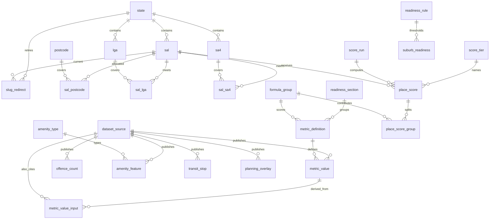

# Data model

National suburb store for Kerbfox. Phase 1 loads Victoria and Tasmania. The keys are national from the first revision, so later states do not need a new shape.

The HTTP API does not read these tables yet. `GET /api/v1/*` still returns `dataset_connected: false`. `contracts/formula.json` remains the methodology the API serves. The database copies that document into `curated.formula_group` and `curated.score_tier` at migrate time so a later scorer and the page share one seed.

Illustrative page JSON, including `data_level` on each section, is `contracts/suburb-response.example.json`. It is not wired into a route.

## Schemas

| Schema | What it holds | Who reads it |
| --- | --- | --- |
| `raw` | Created empty. Loaders may keep file extracts here. Alembic does not manage objects inside it. | Loaders only |
| `staging` | One load, still rejectable. | Loaders only |
| `curated` | Published places, figures, scores, and the Alembic version table. | The API, when it is wired |

Nothing in this revision is created in `public`. Geometries are `geometry(MultiPolygon, 4326)` or `geometry(Point, 4326)`. ABS digital boundaries ship as GDA2020 (EPSG:7844). Loaders transform to 4326 before insert. Typmod rejects the wrong type or SRID. Polygons go through `ST_Multi`. A centroid that falls outside the polygon should be replaced with `ST_PointOnSurface` by the loader. The column is still called `centroid`.

`postgis`, `pg_trgm`, and `btree_gist` are created with `CREATE EXTENSION IF NOT EXISTS` and without a `SCHEMA` clause, so an existing install is left where it is. `btree_gist` is present because the Neon database already has it. This revision does not build an exclusion constraint on it.

Neon already has the three schemas and the three extensions. `kf_loader` is not a superuser and cannot create tables in `public`. `CREATE EXTENSION IF NOT EXISTS` notices that the extension is installed and skips, including for a role that is not a superuser. `CREATE SCHEMA IF NOT EXISTS` skips when the schema exists, but PostgreSQL checks `CREATE` on the database before that skip. The migration role needs that privilege. It does not need to own the schema. Alembic stores `curated.alembic_version` (`version_table_schema = curated`, `include_schemas = true` in `alembic.ini` and `env.py`). `env.py` runs the three `CREATE SCHEMA` statements and commits before Alembic creates the version table, because on a fresh database the schema has to exist first.

Downgrade drops views, then tables, then functions. It does not drop `raw`, `staging`, `curated`, the extensions, or `curated.alembic_version`.

## How a figure is stored

Three states, and they are not interchangeable:

| Situation | What is stored |
| --- | --- |
| The source published a number, including a real zero | `status = ok`, `value` set, `as_of` set, `not_available_reason` null |
| The source says the figure is not published for this place | `status = not_available`, both value columns null, a non-empty `not_available_reason` |
| The loader has not considered the place | No row |

A zero with `status = ok` is a real zero. Writing `0` to mean "unknown" is a loader bug. The check constraint rejects it when the reason is missing, and it rejects a reason on an `ok` row. Text metrics (`gp-note`, `exposure`, `road-noise`, `aircraft-noise`) use `value_text` the same way. A trigger forces `unit` to match `metric_definition` and refuses a number on a text metric.

`quality_flag` is optional: `official`, `modelled`, `suppressed`, `partial_coverage`, `concorded`.

### Geography of the figure

`geo_level` is the geography the number actually describes: `suburb`, `postcode`, `lga`, or `state`.

`fallback_from` is set only when a coarser figure is standing in for a finer one that was missing. It names that finer level, and it must differ from `geo_level`.

| Row is stored on | Native | Fallback |
| --- | --- | --- |
| a suburb (`sal_code`) | `geo_level = suburb`, `fallback_from` null | coarser `geo_level`, `fallback_from` set (usually `suburb`) |
| a council (`lga_code`) | `geo_level = lga`, `fallback_from` null | `geo_level = state`, `fallback_from` set |
| a state | `geo_level = state`, `fallback_from` null | not allowed |

A state median stored on the state row is native. The same median copied onto a suburb, because the suburb has no figure, is `geo_level = state` and `fallback_from = suburb`. Postcode `0800` is legal: postcodes are `text` matching `^[0-9]{4}$`. Postcode `0872` spans the Northern Territory, South Australia, and Western Australia, so `postcode` is not a single-state table.

The same rule is on `offence_count`, `place_score`, and the staging metric and offence loads.

### Section geography

`curated.section_coverage` is one row per filled section of a suburb. A section is filled by at least one `status = ok` metric whose `readiness_section.counts_toward_indexable` is true, or by a composite `place_score` for the `score` section. `not_available` does not fill a section.

The section's `geo_level` is the finest ok geography in that section (`suburb`, then `postcode`, then `lga`, then `state`). One suburb-level school count makes the education section `suburb` even if another education metric is a postcode fallback. `own_figure` for the section means that finest level is `suburb`.

`commute` and `nearby` are seeded with `counts_toward_indexable = false`. Commute waits on a router. Nearby is `ST_Touches`, not a loaded dataset.

## Readiness and the sitemap

Thresholds live in `curated.readiness_rule`, a one-row table (`id = 1`). The seed is `min_sections_filled = 4` and `min_own_figure_sections = 2`. Change the row. Do not copy the numbers into a query.

`curated.suburb_is_indexable(sections_filled, own_figure_sections)` is the only test. It reads that row and returns false when the row is missing. `curated.suburb_readiness` is a live view:

- `sections_filled` counts every filled section.
- `own_figure_sections` counts filled sections whose `geo_level` is `suburb`.
- `indexable` is `suburb_is_indexable(sections_filled, own_figure_sections)`.
- `last_updated` is the newest `coalesce(dataset_source.published_date, metric_value.as_of)` across that suburb's metric rows, including `not_available`.

`curated.sitemap_entry` selects `state_code`, `slug`, `path`, `sal_code`, and `last_updated AS lastmod` from `suburb_readiness` where `indexable`. It does not recompute the flag. A caller filters `state_code` for one state. The page and the sitemap therefore cannot disagree.

The view is not materialised. A second stored copy would be able to drift, and `REFRESH MATERIALIZED VIEW CONCURRENTLY` cannot run inside a function. If the live view is too slow at about 15,000 suburbs, materialise later and keep both the page and the sitemap on that one definition.

## Slugs

The public path is `{state}/{slug}`, generated and stored as `sal.path` (`vic/richmond`). `slug` is the place part only. It is unique per state, matches `^[a-z0-9]+(?:-[a-z0-9]+)*$`, and is permanent.

`curated.slugify_name` and `app.slug.slugify_name` do the same thing: strip a trailing ABS state suffix (`(Vic.)`, `(Tas.)`, `(NSW)`, and the same for the other states, including `OT`), turn `&` into `and`, drop apostrophes, and turn other non-alphanumerics into hyphens. A parenthetical that is not a state stays: `Ascot (Ballarat)` becomes `ascot-ballarat`.

`curated.allocate_slug` appends `-2`, `-3`, and so on when the candidate is already a current slug or a retired one. A rename writes `curated.slug_redirect (state_code, old_slug) → sal_code`. Redirects point at the suburb, not at another slug, so they do not chain. A retired slug cannot be reused. `SAL_CODE_2021` cannot change. The rename trigger sets `kerbfox.slug_rename` for that statement so the collision check allows the in-progress rename.

SA4 and LGA slugs follow the same pattern and are unique per state. They are not redirected by this revision.

## Provenance

`curated.dataset_source` is one fetched version: dataset key, version label, agency, title, licence id and text, `commercial_use_ok`, source URL (`https://`), published date, `fetched_at`, optional `sha256:` checksum, state scope, refresh frequency, and `enabled` or `disabled`.

`commercial_use_ok OR status = disabled` is a check. A non-commercial source cannot be enabled until the flag is flipped. `curated.source_is_loadable` is true only when both are satisfied. Inserts into curated metrics, offence counts, amenity features, transit stops, and planning overlays call it. Updating a row onto a different source calls it again. Disabling a source later does not delete history. Staging may hold a disabled source so it can be inspected. Promotion into curated has to pass the same trigger. There is no promotion procedure in this revision.

Every metric row points at a source version. A derived rate (offences per 1,000 from a count plus population) points at the offence source and lists the population source in `metric_value_input`. If the population is missing, the rate is `not_available`, not zero.

Traditional owners are a string copied from a named source, or both the name and the source are null. The source has to be loadable. They are never inferred. There is no blurb column.

## Scoring

`contracts/formula.json` is the draft: base 50, floor 0, ceiling 100. Groups and ceilings: transport +8, education +8, errands +6, health +5, parks +4, emergency +4, person-offences −12, property-offences −8, deception −4, hazards −8. The tier word is the highest tier whose minimum is less than or equal to the score (clear 80, steady 65, mixed 50, thin 35, sparse 0).

`curated.compute_place_score(sal_code)` raises `feature_not_supported` and does not write a score. `curated.score_input` lists the latest metric per formula group. `skipped` is true when that metric is absent or not `ok`, and `value` stays null.

A group can have more than one metric. The scorer applies the group ceiling once:

| Group | Metrics |
| --- | --- |
| education | `school-count`, `childcare-count` |
| transport | `transit-stops-1km` |
| health | `distance-hospital-m` |
| emergency | `distance-police-m`, `distance-fire-m`, `distance-ambulance-m` |
| errands | `supermarket-count` |
| parks | `park-count`, `canopy-pct` |
| person-offences | `person-rate` |
| property-offences | `property-rate` |
| deception | `deception-rate` |
| hazards | `flood-overlay-pct`, `bushfire-pct` |

`lsio-pct` and `sbo-pct` are Victorian breakdowns. They are not linked to the hazards group, so they are not added on top of `flood-overlay-pct`. Housing is stored and can be ranked. It is not a draft composite input. Distance metrics are direction `negative` while the health and emergency groups are `positive`. Inverting a distance into access points is the scorer's job.

`place_score` stores the composite, the tier, how many inputs were used and skipped, and the score's own `geo_level`. A score stored on a suburb with a coarser `geo_level` means the inputs were a fallback. `place_score_group` stores each group's points. A skipped group has null points, a null raw value, and a `skip_reason`. `chart_value` is an optional 0–100 position and is not the points. `score_run.formula_document` is a snapshot of `formula.json`.

Changing `formula.json` later needs a new migration if `formula_group` should follow it. The methodology route keeps reading the file.

## Places

ABS ASGS Edition 3. `SAL_CODE_2021` is five characters. The first digit is the state (`curated.state.ste_code_2021`): NSW 1, VIC 2, QLD 3, SA 4, WA 5, TAS 6, NT 7, ACT 8, Other Territories 9. Codes whose digits 2–5 are `9494` (no usual address) or `9797` (migratory), and `ZZZZZ`, are not stored. They are balancing items, not suburbs.

`curated.state` includes `ot` with `in_catalogue = false` and a null map centre. The eight catalogue states take their centre and zoom from `contracts/states.json`. The centre in that file is `[longitude, latitude]`.

A suburb can meet more than one LGA or SA4. `area_share` is null or in `(0, 1]`. Exactly one `is_primary` row per suburb (partial unique index). The primary LGA is the largest area share and is the council on the page. `lga.is_council` is false for unincorporated areas. The loader sets it. The primary SA4 is the region (`region_name` / `region_slug` on the page).

`place_key` on a metric or offence row is generated: `sal:<code>`, `lga:<code>`, or `ste:<code>`. Exactly one of those codes is set. Uniqueness is `(place_key, metric_key, period_label)`. Time series are further rows of the same metric key (`2021`, `2024-Q3`), not extra keys.

`curated.sal_neighbour` is suburbs whose polygons touch (`geom &&` and `ST_Touches`). An overlap is not a neighbour.

Search uses `pg_trgm` on `lower(sal.sal_name)` and `lower(lga.name)`.

## Tables

### `curated`

| Table | Role |
| --- | --- |
| `state` | Catalogue states plus Other Territories. |
| `dataset_source` | One fetched version, its licence, and whether it may be loaded. |
| `sa4` | Statistical Area Level 4. Three-digit code. The page region. |
| `lga` | Local government area, five-digit code, optional boundary. |
| `postcode` | Four-digit postcode. Not tied to one state. |
| `sal` | Suburb or locality. `SAL_CODE_2021`, name, slug, path, MultiPolygon, centroid, area, ASGS loci URI, traditional owners. |
| `sal_postcode` | Suburb to postcode. One primary. |
| `sal_lga` | Suburb to council, with area share. One primary. |
| `sal_sa4` | Suburb to SA4, with area share. One primary. |
| `slug_redirect` | Retired `{state}/{slug}` pointing at the current suburb. |
| `formula_group` | Seeded copy of the draft composite groups. |
| `score_tier` | Seeded copy of the tier words and minimums. |
| `readiness_rule` | Singleton indexable thresholds. |
| `readiness_section` | Page section id, and whether a filled section counts. |
| `metric_definition` | Metric key, label, section, unit, direction, numeric or text, optional formula group. |
| `metric_value` | One figure: place, metric, period, value or text, unit, geo level, fallback, source, status. |
| `metric_value_input` | Extra sources used to derive a figure, such as the population behind a rate. |
| `offence_count` | Recorded count by category (`person`, `property`, `deception`, `other`) and offence name. Rate optional. |
| `amenity_type` | School, childcare, park, hospital, police, fire, ambulance, supermarket, and the other place groups. |
| `amenity_feature` | A named point and the source feature id. |
| `transit_stop` | A GTFS stop. Mode is train, tram, bus, regional rail, ferry, light rail, or other. |
| `planning_overlay` | Flood, bushfire, or other polygon. Percentages are metrics, not columns. |
| `score_run` | One calculation, with the formula document it used. |
| `place_score` | Composite, tier, inputs used and skipped, geo level. |
| `place_score_group` | Points or a skip reason for one group. |
| `alembic_version` | Owned by Alembic. Not in the SQLAlchemy models. Not dropped on downgrade. |

Views: `section_coverage`, `suburb_readiness`, `sitemap_entry`, `score_input`, `sal_neighbour`.

Functions: `slugify_name`, `allocate_slug`, `source_is_loadable`, `compute_place_score` (stub), `suburb_is_indexable`. The rest are triggers.

### `staging`

`load_batch` records a run (`running`, `validated`, `promoted`, `rejected`, `failed`). Child tables, all keyed by the batch, are `sal_load`, `metric_value_load`, `amenity_feature_load`, `transit_stop_load`, `planning_overlay_load`, and `offence_count_load`. Metric and offence loads use the same status and geo-level checks as curated, so a zero cannot be laundered on the way in.

### `raw`

Schema only.

## Metric keys

Every slot id in `src/metrics/registry.ts` is a `metric_key`, including the series slots. A series such as rent over time is several `metric_value` periods of `median-rent`, not a new key. Map metrics match the registry: `median-rent`, `median-house`, `person-rate`, `hot-days`, `canopy-pct`.

Keys that are not registry slots: `population`, `childcare-count`, `transit-stops-1km`, `distance-hospital-m`, `distance-police-m`, `distance-fire-m`, `distance-ambulance-m`, `distance-gp-m`, `distance-supermarket-m`, `flood-overlay-pct`, `park-count`, `supermarket-count`, `pharmacy-count`.

Counts and distances are derived from `amenity_feature` and `transit_stop` and then stored. The request path does not scan those tables.

## Page contract

`contracts/suburb-response.example.json` is an example (`example: true`). Figures use placeholder Richmond values and `SAL_CODE_2021` `20000`. They are not gazetteer facts. Each figure has `value`, `unit`, `source` (`name`, `agency`), `licence` (`id`, `text`), `as_of`, `status` (`ok` or `not_available` with `reason`), `geo_level`, and `fallback_from`.

Each of overview, score, housing, education, transport, services, safety, climate_hazards, and amenities has `data_level`, the section geography, so the frontend can say "based on postcode-level data". `meta` carries `state`, `slug`, `sections_filled`, `own_figure_sections`, `indexable`, `last_updated`, the section id lists, and the thresholds. The example is indexable because 9 filled sections and 5 suburb-level sections meet 4 and 2. Bushfire `0` with `status: ok` is the real-zero case.

## Victoria and Tasmania

Licences below were checked where a page is named. Everything else is copied from the file at fetch time and the source stays `disabled` until `commercial_use_ok` is true. Do not seed a licence from memory. Domain and CoreLogic are not sources.

| Dataset | Lands in | Licence note |
| --- | --- | --- |
| ABS ASGS Edition 3 digital boundaries (SAL, LGA, SA4) and correspondences. Census 2021 GCP at SAL. | `sal`, `lga`, `sa4`, `sal_lga`, `sal_sa4`, `sal_postcode` (POA is a correspondence, not a delivery allocation), census `metric_value` | CC BY 4.0. Commercial use is allowed. SAL fields include `SAL_CODE_2021`, `SAL_NAME_2021`, `STATE_CODE_2021`, `AREA_ALBERS_SQKM`, `ASGS_LOCI_URI_2021`. Names look like `Richmond (Vic.)`. Boundaries are mesh-block approximations, not legal boundaries. |
| Crime Statistics Agency Victoria, recorded offences, on DataVic | `offence_count`, and category rates in `metric_value` | CC BY 4.0 on the DataVic dataset page. The official listing emphasises state and LGA workbooks. Suburb and postcode tables exist in the CSA series. Use the agency file, not a republication. Rates per 1,000 use ABS population via `metric_value_input`. Youth is often LGA, so a suburb `youth-rate` is `not_available` with a reason. Footfall belongs in `notes`. |
| Tasmania Police / DPFEM crime | `offence_count` when a suburb file exists | Licence not confirmed. Leave disabled. A missing suburb series is `not_available`, not a zero. |
| Victorian rental report (DFFH) and Valuer-General sales | `median-rent`, `median-house`, `median-unit` | Copy the file licence before enable. |
| Tasmania rent and suburb sale medians | same metrics | A published open series may not exist. `not_available` rather than a portal scrape. |
| Dwelling approvals | `approvals` | Often SA2 or LGA. Store the coarser `geo_level` with `fallback_from`. |
| Victoria PTV/DTP GTFS on DataVic | `transit_stop`, then `transit-stops-1km` and line counts | Historically CC BY 4.0. Confirm on the resource. |
| Tasmania GTFS (Transport Services / Building Tasmania) | `transit_stop` | Licence not stated on the pages checked. Disabled until it is recorded. |
| Victoria school locations (department, DataVic) | `amenity_feature` type `school`, then `school-count` | Typically CC BY. Confirm on the resource. |
| Tasmania school locations (LIST or the department) | same | Copy the layer licence. |
| ACECQA national childcare register | `amenity_feature` type `childcare` | Licence not confirmed. Disabled until it is. |
| Victoria planning overlays (LSIO, SBO, bushfire) | `planning_overlay` (`flood` for LSIO and SBO, `bushfire` for the bushfire overlay) and `lsio-pct`, `sbo-pct`, `flood-overlay-pct`, `bushfire-pct` | Confirm the layer. Some Vicmap products are restricted. |
| Tasmania LIST flood-prone and bushfire-prone areas | `planning_overlay` and the national percentage metrics | Land Tasmania open data is described as CC BY 3.0 AU, and some layers are excluded. Copy the layer licence. Tasmania does not publish LSIO or SBO, so those two metrics are `not_available`. |
| OpenStreetMap amenities | `amenity_feature` | ODbL is share-alike. `commercial_use_ok` stays false and the source stays disabled until counsel decides. |
| NAPLAN / ACARA, Bureau of Meteorology heat, canopy, noise, GP lists | the matching metrics | Treat as unconfirmed or non-commercial. `disabled`, and the page shows `not_available`. |
| Postcodes | `postcode`, `sal_postcode` | ABS POA correspondence is CC BY and is not a true allocation. Australia Post and Geoscape / G-NAF need a licence decision. |

Edition 3 codes are not stable against ASGS 2016. A later edition is a new code, a crosswalk, and new rows. It is not a rewrite of `slug`. There is no crosswalk table in this revision. `asgs_loci_uri` is on `sal`.

## Decisions for the team

- Indexable starts at 4 filled sections and 2 suburb-level sections. Edit `readiness_rule`.
- A source with `commercial_use_ok = false` cannot be `enabled`. That interlock is in the table, not only in a loader.
- Primary council is the largest `area_share`.
- `last_updated` includes `not_available` rows, because a published gap is still an update.
- The composite is not computed in the database. The stub records the rule: skip a missing input, do not store it as zero.
- Housing is rankable and is outside the draft composite.
- `planning_overlay` keeps polygons in curated so the map does not need a second store. Percentages remain the page figures.
- `btree_gist` is created and unused.
- The readiness view is live. Materialise it later only if the page and the sitemap still share one definition.
- Council-list paging is a separate product question. This schema does not answer it.

